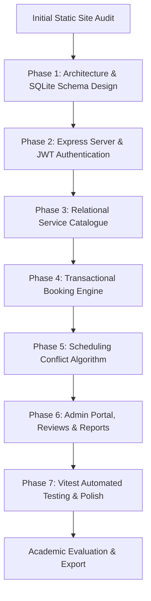
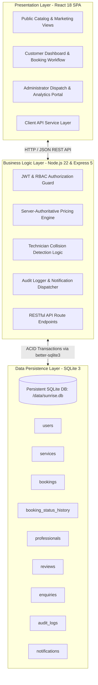
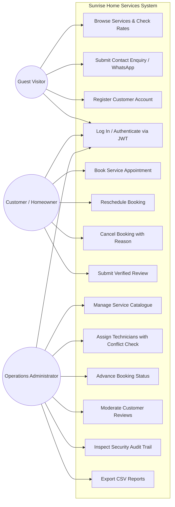
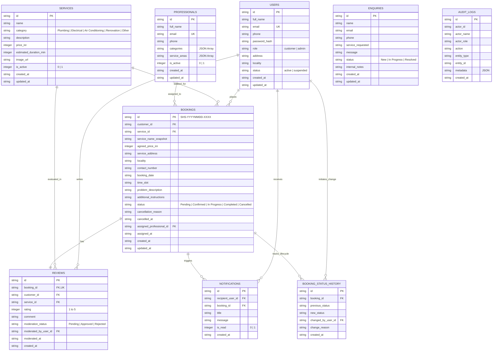
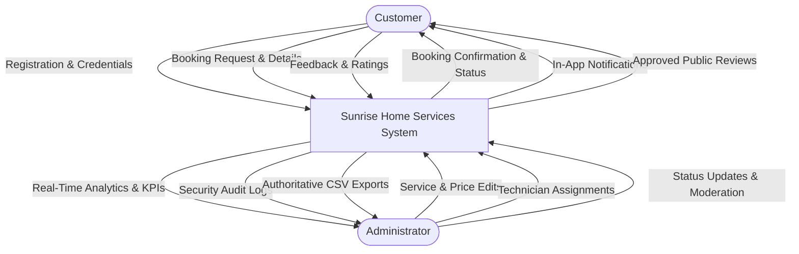
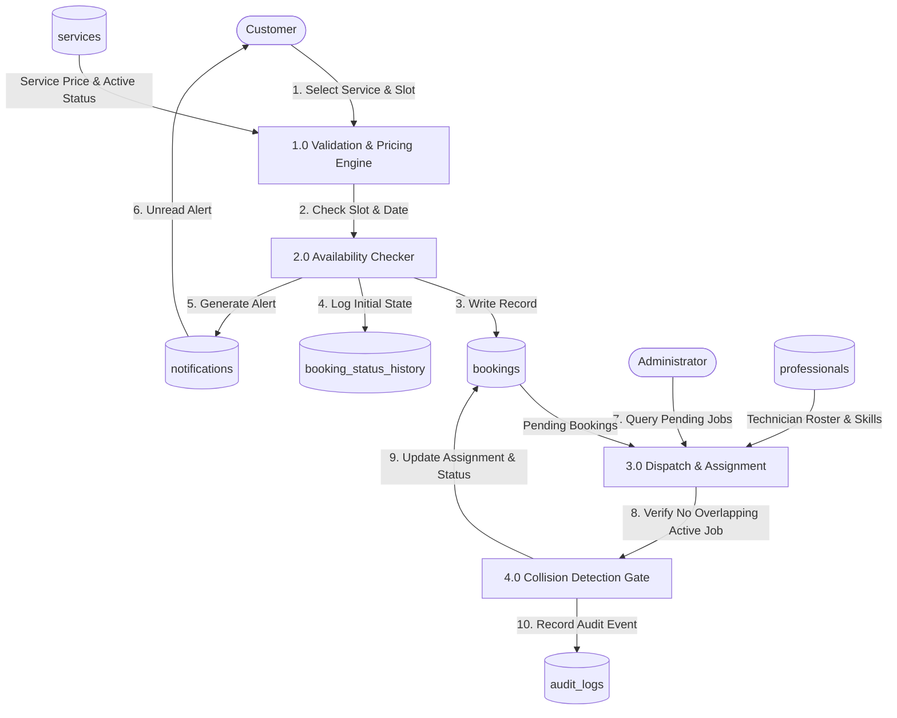

# Academic Project Documentation
## Sunrise Home Services — Full-Stack Service Booking and Management System
**Degree Course:** Third Year B.Sc. Computer Science (Semester 5)  
**Curriculum Component:** Mini-Project Assessment  
**Author:** Bhumika Nikam  
**Academic Year:** 2026–2027  

---

## 1. SDLC Methodology & Justification

The **Agile Incremental Software Development Life Cycle (SDLC)** was chosen for Sunrise Home Services. 

### Justification:
1. **Incremental Enhancement of Existing Work**: The initial project existed as a static HTML/CSS/JavaScript layout. An incremental model allowed preserving original visual branding, typography, and marketing assets while iteratively attaching database persistence, authentication, business logic, and reporting.
2. **Test-Driven Verification**: Each increment (Authentication → Services → Bookings → Technician Scheduling → Reviews → Reporting) was verified through automated unit/integration tests before progressing to subsequent modules.
3. **Risk Mitigation**: Business constraints such as technician scheduling collisions and client price tampering were resolved early in backend middleware before final UI assembly.

---

## 2. System Architecture Diagram

The system follows a three-tier architecture with clear separation of presentation, business logic, and relational persistence.

---

## 3. Use-Case Diagram

---

## 4. Entity-Relationship (ER) Diagram

---

## 5. Data Flow Diagrams (DFD)

### Level 0 Context Diagram

### Level 1 Data Flow Diagram (Booking & Dispatch Process)

---

## 6. Functional & Non-Functional Requirements Specification (SRS)

### Functional Requirements
- **FR1**: System must allow customers to register with full name, email, phone, locality, and password. Public registration must strictly create `customer` accounts.
- **FR2**: System must enforce authentication using JSON Web Tokens (JWT) and reject passwords that fail bcrypt hash verification.
- **FR3**: The server must authoritatively determine service prices based on database records, ignoring client-submitted prices.
- **FR4**: System must reject past dates and invalid time slots.
- **FR5**: Each booking must receive a unique reference formatted as `SHS-YYYYMMDD-XXXX`.
- **FR6**: System must allow customers to cancel eligible bookings (`Pending` or `Confirmed`) with a mandatory cancellation reason.
- **FR7**: System must prevent assigning a technician who already has an active assignment (`Confirmed` or `In Progress`) on the same date and slot.
- **FR8**: Only completed bookings can be reviewed by their customer. Reviews cannot be submitted more than once for a single booking.
- **FR9**: Public site must only display `Approved` reviews and dynamically compute average ratings.
- **FR10**: System must log sensitive operations to an immutable audit table.

### Non-Functional Requirements
- **NFR1 (Security)**: Passwords hashed with 10 rounds of bcrypt. Role-based access control guards all administrative endpoints. Customer records are isolated.
- **NFR2 (Reliability & ACID Compliance)**: SQLite configured with WAL mode (`PRAGMA journal_mode = WAL`) and foreign key enforcement (`PRAGMA foreign_keys = ON`). Atomic transactions wrap multi-table state changes.
- **NFR3 (Performance)**: Server responds to API queries in under 50ms. Indexes placed on `customer_id`, `status`, `booking_date`, and `assigned_professional_id`.
- **NFR4 (Usability & Responsiveness)**: Responsive design across mobile, tablet, and desktop viewports with Poppins typography.
- **NFR5 (Portability)**: Zero-configuration local execution using Node.js without needing external cloud database subscriptions.

---

## 7. Test Plan & Actual Execution Matrix

Testing was performed using **Vitest 5.0.4** and **Supertest 7.3.1**. All 20 tests executed with 100% pass rate.

| Test Case ID | Test Description | Target Module | Expected Result | Actual Result | Status |
|---|---|---|---|---|---|
| **TC-01** | Rejects login with invalid password | Auth | HTTP 401 Unauthorized | HTTP 401 Unauthorized | **PASS** |
| **TC-02** | Customer registration & role enforcement | Auth | HTTP 201 with role='customer' | Role is strictly 'customer' | **PASS** |
| **TC-03** | Rejects registration with duplicate email | Auth | HTTP 409 Conflict | HTTP 409 Conflict | **PASS** |
| **TC-04** | Protects admin endpoints from customers | Security | HTTP 403 Forbidden | HTTP 403 Forbidden | **PASS** |
| **TC-05** | Retrieves active services catalogue | Services | HTTP 200 with active array | HTTP 200 with prices & duration | **PASS** |
| **TC-06** | Service search & category filtering | Services | Filtered service items | Correct category subsets | **PASS** |
| **TC-07** | Booking creation with server price | Bookings | Unique ID format & server price | `SHS-YYYYMMDD-XXXX` created | **PASS** |
| **TC-08** | Rejection of past booking dates | Bookings | HTTP 400 Bad Request | Rejection error returned | **PASS** |
| **TC-09** | Rejection of invalid time slots | Bookings | HTTP 400 Bad Request | Rejection error returned | **PASS** |
| **TC-10** | Customer rescheduling pending booking | Bookings | HTTP 200, date/slot updated | Booking rescheduled | **PASS** |
| **TC-11** | Customer cancellation with valid reason | Bookings | HTTP 200, status='Cancelled' | Status changed, reason logged | **PASS** |
| **TC-12** | Rejection of duplicate cancellation | Bookings | HTTP 400 Bad Request | Rejection error returned | **PASS** |
| **TC-13** | Fresh booking for assignment test | Bookings | HTTP 201 Created | Created successfully | **PASS** |
| **TC-14** | Assign technician Santosh (prof_001) | Scheduling | HTTP 200, status='Confirmed' | Professional assigned | **PASS** |
| **TC-15** | Overlapping scheduling collision check | Scheduling | HTTP 409 Conflict | Conflict detected & blocked | **PASS** |
| **TC-16** | Rejects review for non-completed booking | Reviews | HTTP 400 Bad Request | Rejection error returned | **PASS** |
| **TC-17** | Saves contact enquiry to database | Enquiries | HTTP 201 Created | Saved with status 'New' | **PASS** |
| **TC-18** | Calculates real summary metrics | Reports | Total count & values calculated | Accurate financial metrics | **PASS** |
| **TC-19** | Exports bookings as CSV for admin | Reports | text/csv content type | Valid CSV spreadsheet output | **PASS** |
| **TC-20** | Retrieves immutable audit trail | Audit | Chronological log list | Audit actions recorded | **PASS** |

---

## 8. Known Limitations & Future Scope

### Known Limitations:
1. **SMS / Email Gateways**: The application delivers in-app notifications and formats WhatsApp direct communication strings. Live SMS gateways (e.g. Twilio) were not integrated to avoid external recurring billing charges.
2. **Online Payment Processing**: The project implements a "Pay on Service Completion" model (Cash / UPI) to avoid external banking payment gateway merchant approvals.

### Future Scope:
1. **GPS Live Tracking**: Integrating technician geolocation on a real-time Pune map to show estimated time of arrival (ETA).
2. **Automated Inventory Tracking**: Linking replacement parts (valves, pipes, capacitors) with service costs and technician vans.
3. **PWA Mobile App**: Converting into an installable Progressive Web App for offline technician job sheet caching.
